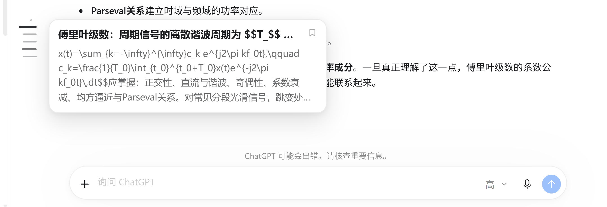
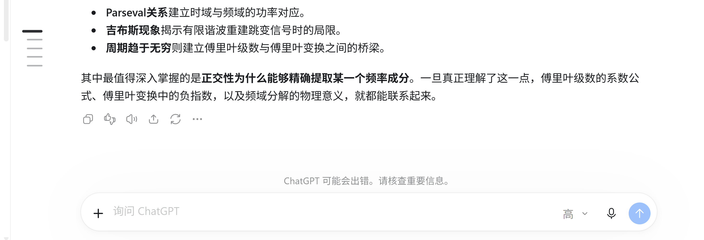

# ChatGPT Nav Rail

**Chat 模式的"提问导航"——左侧一列刻度，点一下就跳到那条消息。**

[](#)
[](#)
[](#changelog)
[](LICENSE)
[](#why-not-patch-the-app)



ChatGPT 桌面端的 Chat 模式里，长对话翻起来很累：想回到某个提问，只能一路往上滚。这个项目在正文左侧加了一条极简导航——**只对应你提的问题**，悬停出摘要，点击直达。

---

## Features

| | |
|---|---|
| 🎯 **只给提问做导航** | 只统计你的消息（`[data-user-message-bubble]`），AI 的回答不占用刻度；同一轮里的多次追问各自成条 |
| 🖱️ **点击直达** | 点刻度 → 平滑滚动到该消息并描边高亮；目标已被虚拟化卸载时，走有界"寻址"把它找回来 |
| 👀 **悬停预览** | 加粗标题 + 灰色摘要（最多 4 行），不用跳过去就能想起那条问了什么 |
| 🧭 **跟随当前阅读位置** | 当前那条刻度加粗变深（IntersectionObserver 判定，不靠像素推算） |
| ⌨️ **全键盘** | `Alt+↑/↓` 上下条、`Alt+Home/End` 首尾、`Alt+B` 收藏、`Alt+N` 收起 |
| 🎨 **贴合原生** | 跟随应用主题变量（浅色/深色一致），Shadow DOM 隔离，不污染页面样式 |
| 🫥 **不挡点击** | 只有 28px 宽的轨道条接收鼠标事件，预览卡完全不拦截 |
| 🧩 **不改安装包** | `app.asar` 零改动，卸载即干净 |



---

## Install

### 环境

- Windows 10/11
- ChatGPT 桌面端（`OpenAI.Codex` 包，ChatGPT↔Codex 合并版）
- Node.js ≥ 18（用于注入器与看护）
- PowerShell 5.1+（系统自带）

### 三步

```powershell
git clone https://github.com/<you>/chatgpt-nav-rail.git
cd chatgpt-nav-rail
powershell -ExecutionPolicy Bypass -File .\install.ps1
```

`install.ps1` 会：

1. 建桌面 / 开始菜单快捷方式 **「ChatGPT (消息导航栏)」**；
2. 注册登录自启（看护，无窗口）；
3. 立刻拉起一次（应用 + 注入器），使导航就绪。

之后请用那个快捷方式启动 ChatGPT——它会在启动时就带上调试端口，一次到位、无需重启。

### 卸载

```powershell
powershell -ExecutionPolicy Bypass -File .\uninstall.ps1
```

删除快捷方式与自启项、停掉看护与注入器；ChatGPT 本体不受任何影响（只是在下次正常启动时不再带调试端口）。

---

## Usage

| 操作 | 效果 |
|---|---|
| 点刻度 | 跳到那条提问，目标描边 1.2s |
| 悬停刻度 | 弹出发送内容摘要（标题 + 正文前 4 行） |
| `Alt+↑` / `Alt+↓` | 上一条 / 下一条提问 |
| `Alt+Home` / `Alt+End` | 第一条 / 最后一条 |
| `Alt+B` 或点卡片右上角书签 | 收藏该提问（按会话本地保存，刻度左侧出现小圆点） |
| `Alt+N` 或悬停轨道顶部小箭头 | 收起 / 展开 |

显示条件：**≥2 条提问**、**正文左侧留白 ≥48px**、**当前是 Chat 模式**、**官方导航条不可见**。

---

## How it works

```
┌─────────────────────────────┐
│ ChatGPT (Electron + MSIX)   │
│  app://-/index.html         │  ← 本地 React 包，聊天正文在这里
└──────────────┬──────────────┘
               │ CDP (127.0.0.1:9333)
┌──────────────┴──────────────┐
│ injector/daemon.mjs         │  注入 payload.js，并在刷新/新窗口时重注入
│ supervisor.mjs              │  应用起→注入器起；应用关→注入器退出
└─────────────────────────────┘
```

1. 启动器用 **AUMID**（`OpenAI.Codex_2p2nqsd0c76g0!App`）激活应用并附带 `--remote-debugging-port=9333`；
2. 注入器连上 CDP，把 `injector/payload.js` 注入每个 `app://` 窗口，并注册 `Page.addScriptToEvaluateOnNewDocument`，保证刷新/导航后仍在；
3. `payload.js` 在页面里用 Shadow DOM 画导航条，靠应用自己的 `data-*` 语义钩子定位消息。

### Why not patch the app?

安装目录在 `C:\Program Files\WindowsApps\...`：**只读 + MSIX 签名校验**，每次更新整目录被替换。任何对 `app.asar` 的修改都会被覆盖或导致校验失败。所以这里一行安装包代码都没动，全部是运行时注入。

### 抗更新

| 层 | 做法 |
|---|---|
| 入口 | 用 AUMID（由签名证书派生，跨版本不变），不写版本号/路径 |
| 定位 | 只用应用自己的语义钩子（见下表），每个钩子都是候选列表 |
| 自愈 | `MutationObserver` + `ResizeObserver` + 1s 节拍 + 注入器重连 |
| 让位 | 官方导航条可见时自动隐藏，避免两条轨道叠在一起 |
| 隔离 | Shadow DOM；`pointer-events` 只在窄轨上开启 |

| 用途 | 选择器 |
|---|---|
| 滚动容器 | `.thread-scroll-container`（多个并存时取"可见且最高"） |
| 会话根 | `[data-thread-find-target="conversation"]` |
| 你的提问 | `[data-user-message-bubble]` → `[data-local-conversation-user-anchor]` → `[data-conversation-role="user"]` 的父级 |
| 模式判定 | `[data-turn-key]` 且非 `turn-N`；辅以模式按钮 `[aria-label^="切换模式"]` |
| 官方导航条 | `[data-thread-user-message-navigation-rail-list]` |

---

## Limitations

- **只覆盖已加载的消息。** 该应用的 transcript 是 **6 条一窗**的滑动窗口，更早的历史要滚动到顶部、由应用自己分页取回后才存在。项目采用「被动累积 + 点击时寻址」：刻度只增不减，跳到未挂载的已知条目时会做有界滚动（≤40 步）把它找回来；**不会凭空列出应用尚未加载的历史**。
- **不主动滚动页面。** 后台不扫描、不隐藏内容、不改布局——这既是性能考虑，也是为了不干扰点击。
- **调试端口对本地开放。** `127.0.0.1:9333` 等同于开着 DevTools，任何本机进程都能连上。不要暴露到局域网，也不要在共享机器上常开。
- **应用大版本重构后可能需要补一条选择器**（见上表，改 `injector/payload.js` 顶部 `SELECTORS` 即可）。

---

## FAQ

**Q：为什么启动时要求用「ChatGPT (消息导航栏)」快捷方式？**
A：Chromium 的调试端口只能在进程启动那一刻通过命令行开启，而 MSIX 应用的开始菜单/任务栏图标由系统托管、无法改写目标。用我们的快捷方式 = 启动时直接带端口，零重启；用原图标 = 本次没有导航（可以从托盘退出后用快捷方式再开，或开启 `autoRestart`）。

**Q：`autoRestart` 是什么？**
A：`config.json` 里的开关。`true` 时，看护发现"应用刚启动但没带端口"会在早期把它换成带端口的实例（会有一次快速重启）；默认 `false`，绝不主动杀进程。

**Q：会不会拖慢应用？**
A：页面内只有一个 1s 节拍（窗口不可见时完全停表），注入器与看护空闲 CPU ≈ 0，内存约 40–60MB/进程。

**Q：Work / Codex 模式会重复出现两条导航吗？**
A：不会。检测到官方导航条可见、或处于 Codex/Work（`turn-N`、`main[data-thread-user-message-navigation-content]`）时，本插件立即隐藏。

---

## Development

```
├─ injector/
│  ├─ payload.js      # 页面内导航条（唯一需要随改版维护的文件）
│  └─ daemon.mjs      # CDP 注入器
├─ supervisor.mjs     # 生命周期看护（应用起→注入起；应用关→注入退）
├─ launch.ps1         # 幂等启动：确保端口 + 注入器
├─ restart-with-cdp.ps1
├─ install.ps1 / uninstall.ps1
├─ supervisor-hidden.vbs
└─ tools/             # 自检与调试（CDP 求值、点击、截图、回归）
```

自检：

```powershell
node tools\verify.mjs          # 已注入？有多少刻度？
node tools\verify-click.mjs    # 点击穿透（网格命中测试 + 真实点击）
node tools\verify-guard.mjs    # 官方导航条出现时是否让位
node tools\regress.mjs         # 多会话回归：用户气泡数 vs 刻度数
```

日志：`%LOCALAPPDATA%\ChatGPTNavRail\{nav,injector,supervisor}.log`

---

## AI prompts

想把这个项目交给 AI 继续维护/复刻？仓库里带了三段可直接复制的提示词：[docs/AI-PROMPTS.md](docs/AI-PROMPTS.md)。

## Credits

- 交互与"不在池中时如何寻址"的思路参考了 [AI-MarkDone](https://github.com/zhaoliangbin42/AI-MarkDone) 的 message directory 实现（ADR-0027 有界单调寻址）。
- 视觉样式对齐 ChatGPT 桌面端自带的浮动导航条。

## License

[MIT](LICENSE)
